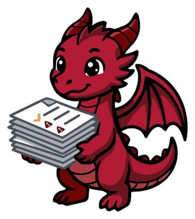

<p align="center">
  
</p>

<h3 align="center">Kubernetes-native Software Bill of Materials (SBOM) Visualization & Governance Platform</h3>

<p align="center">
  <a href="https://github.com/seebom-labs/BOMHort/actions/workflows/ci.yml"></a>
  <a href="https://scorecard.dev/viewer/?uri=github.com/seebom-labs/BOMHort"></a>
  <a href="https://www.bestpractices.dev/projects/12903"></a>
</p>

Ingest 1000+ SPDX and CycloneDX SBOMs, scan for vulnerabilities via OSV, enforce license compliance, and apply VEX statements — all visualized in a fast Angular dashboard backed by ClickHouse analytics.

**BOMHort** (formerly known as SeeBOM) is the same project with a new name. Read more: [Why we renamed SeeBOM to BOMHort](docs/content/docs/getting-started/rename.md).

<p align="center">
  <a href="https://docs.bomhort.dev/docs/getting-started/">Getting Started</a> ·
  <a href="https://docs.bomhort.dev/docs/deployment/">Deployment</a> ·
  <a href="https://docs.bomhort.dev/docs/api-reference/">API Reference</a> ·
  <a href="https://docs.bomhort.dev/docs/architecture/">Architecture</a> ·
  <a href="https://docs.bomhort.dev/docs/roadmap/">Roadmap</a> ·
  <a href="https://docs.bomhort.dev/docs/development/contributor-ladder/">Contributing</a>
</p>

<p align="center">
  
</p>

---

## What it does

- **Ingests at scale** — SPDX 2.x JSON, SPDX 3 JSON-LD, CycloneDX 1.0–1.7 and in-toto attestation envelopes, auto-detected, from S3-compatible buckets, a directory, or `POST /api/v1/sboms/upload`. Deduplicated by SHA-256, retained forever.
- **Finds vulnerabilities** — OSV batch lookups at ingest, plus a daily refresher that checks every known package URL for newly disclosed CVEs without re-scanning a single SBOM. Findings carry their CVE id and all aliases.
- **Applies VEX** — OpenVEX statements scoped to the SBOM whose product they describe, with provenance; order of arrival does not matter.
- **Enforces license policy** — an externalized permissive/copyleft policy, SPDX expression evaluation, and reviewed exceptions that reload live and apply retroactively to every SBOM already ingested. Unknown licenses are resolved from GitHub, npm, NuGet, deps.dev, Packagist and PyPI, and every package records where its license came from — or why it is still unknown.
- **Shows ownership** — every record is tagged with cluster, namespace and project (from configuration or the ingestion path) and free-form tags, so a fleet reads as a tree, not a list.
- **Serves agents** — an optional read-only [MCP server](https://docs.bomhort.dev/docs/mcp/) exposes the same REST contract to AI assistants, without database credentials.

## Quick Start

```bash
git clone https://github.com/seebom-labs/BOMHort.git && cd BOMHort
cp .env.example .env            # optional: SBOM source, GitHub token, worker count
# drop your SBOMs (and *.openvex.json files) into sboms/, then
make dev                        # ClickHouse + API + workers + UI via Docker Compose
```

Open **http://localhost:8090**. The API is on `localhost:8080`, ClickHouse on `localhost:9000`.

| Want to… | Run | Details |
|---|---|---|
| Try it on a local Kubernetes cluster | `make kind-up` | [Kind example](examples/kind/) |
| Iterate on the code with hot reload | `make ch-only && make ch-migrate`, then `make api` / `make worker` / `make ui-dev` | [Development](https://docs.bomhort.dev/docs/development/) |
| Deploy to Kubernetes | `helm install bomhort oci://ghcr.io/seebom-labs/bomhort/charts/bomhort` | [Deployment guide](https://docs.bomhort.dev/docs/deployment/), [example values](examples/kubernetes/) |

`make help` lists every target.

## Configuration

Everything is configured through environment variables (locally: `.env`; in Kubernetes: Helm values rendered into a ConfigMap) and three JSON files. Nothing is downloaded or approved silently.

| What | Where | Documentation |
|---|---|---|
| SBOM sources — S3 buckets, directory, push uploads | `S3_BUCKETS`, `SBOM_SOURCE_DIR` | [Deployment → SBOMs](https://docs.bomhort.dev/docs/deployment/#1-sboms--getting-data-into-the-cluster) |
| Ownership — cluster, namespace, project, tags | `CLUSTER_NAME`, `NAMESPACE`, `PROJECT`, `INGEST_PATH_LAYOUT`, `TAGS` | [Fleet Views](https://docs.bomhort.dev/docs/ownership/) |
| License policy — which SPDX IDs are permissive or copyleft, how expressions fold | `license-policy.json`, `LICENSE_EXPRESSION_MODE` | [Deployment → License Policy](https://docs.bomhort.dev/docs/deployment/#4-license-policy) |
| License exceptions — reviewed approvals from Helm values, your own ConfigMap, or an https / S3 source; reloaded live, applied retroactively | `license-exceptions.json`, `EXCEPTIONS_SOURCE`, `EXCEPTIONS_REFRESH_INTERVAL` | [License Exceptions](https://docs.bomhort.dev/docs/license-exceptions/), [example](examples/license-exceptions/) |
| License resolution — registry resolvers, normalization, provenance | `GITHUB_TOKEN`, `SKIP_*_RESOLVE` | [License Resolution](https://docs.bomhort.dev/docs/license-resolution/) |
| UI branding — theme CSS, texts, logo | `CUSTOM_THEME`, `UI_CONFIG`, `ui.siteConfig` | [Deployment → Custom Theme / Site Configuration](https://docs.bomhort.dev/docs/deployment/#5-custom-theme) |
| API authentication, query limits, upload size | `AUTH_ENABLED`, `SERVICE_TOKEN`, `API_KEYS`, `CLICKHOUSE_MAX_*`, `MAX_UPLOAD_SIZE_MB` | [Deployment → API Authentication](https://docs.bomhort.dev/docs/deployment/#7-api-authentication-optional) |

The complete variable reference with defaults is in [Getting Started → Configuration](https://docs.bomhort.dev/docs/getting-started/#configuration-env); `.env.example` documents the same set inline.

## Architecture

```
  S3 buckets / directory / POST upload
                │
                ▼
   ┌──────────────────────┐   CronJob: lists sources, deduplicates by
   │  Ingestion Watcher   │   SHA-256, enqueues jobs in ClickHouse
   └──────────┬───────────┘
              ▼
   ┌──────────────────────┐   N stateless replicas: parse, resolve
   │  Parsing Workers     │   licenses, batch-insert, OSV lookup,
   └──────────┬───────────┘   license check, VEX, exception re-check
              ▼
   ┌──────────────────────┐   ┌──────────────────────┐
   │  ClickHouse          │◄──│  CVE Refresher       │  daily: new CVEs
   └──────────┬───────────┘   └──────────────────────┘  for known PURLs
              ▼
   ┌──────────────────────┐   stateless REST API
   │  API Gateway         │◄──────────────┐
   └──────────┬───────────┘               │
              ▼                           │
   ┌──────────────────────┐   ┌───────────┴──────────┐
   │  Angular UI          │   │  MCP Server (opt.)   │  read-only tools,
   └──────────────────────┘   └──────────────────────┘  no DB credentials
```

Five Go binaries, one Angular UI, one ClickHouse database, one Helm chart, one repository. The parsing pipeline resolves licenses *before* inserting, so the stored packages carry the resolved values from the start. Details: [Architecture](https://docs.bomhort.dev/docs/architecture/), [ARCHITECTURE_PLAN.md](docs/ARCHITECTURE_PLAN.md).

## Documentation

| Page | Covers |
|---|---|
| [Getting Started](https://docs.bomhort.dev/docs/getting-started/) | Docker Compose, Kind, hot reload, every environment variable |
| [Deployment](https://docs.bomhort.dev/docs/deployment/) | Helm chart: SBOM sources, ownership, license policy, theming, authentication, ingress, upgrades |
| [License Exceptions](https://docs.bomhort.dev/docs/license-exceptions/) | Exception sources, live reload, retroactive application, Argo CD |
| [License Resolution](https://docs.bomhort.dev/docs/license-resolution/) | How a package gets its license, and the decision log behind every heuristic |
| [Fleet Views](https://docs.bomhort.dev/docs/ownership/) | Cluster → namespace → project, tags, a runnable demo |
| [API Reference](https://docs.bomhort.dev/docs/api-reference/) | All REST endpoints with request and response examples |
| [MCP Server](https://docs.bomhort.dev/docs/mcp/) | Running the MCP server and what an agent can ask |
| [Architecture](https://docs.bomhort.dev/docs/architecture/) | Components, data model, parsing pipeline |
| [Release](https://docs.bomhort.dev/docs/release/) | Support policy, release branches, backports |
| [Development](https://docs.bomhort.dev/docs/development/) | Code style, tests, parsers, contributor ladder, AI policy |
| [FAQ](https://docs.bomhort.dev/docs/faq/) | Common questions and troubleshooting |

In-repo: [DEPLOYMENT_GUIDE.md](docs/DEPLOYMENT_GUIDE.md) · [RELEASE.md](docs/RELEASE.md) · [TESTING.md](docs/TESTING.md) · [examples/](examples/)

## Tech Stack

| Layer | Technology |
|-------|-----------|
| Backend | Go 1.26, `net/http` (stdlib), seven direct dependencies |
| Database | ClickHouse (MergeTree family), managed by the ClickHouse Operator in Kubernetes |
| Frontend | Angular, standalone components, CDK virtual scrolling |
| Vulnerabilities | OSV.dev API |
| VEX | OpenVEX |
| Deployment | Helm 3, Docker Compose |

## Subprojects

The `seebom-labs` organization hosts additional BOMHort subprojects:

- [BOMcompare](https://github.com/seebom-labs/BOMcompare) — Lightweight SBOM comparison tool.
- [bomhort-website](https://github.com/seebom-labs/bomhort-website) — Public website and landing pages for BOMHort.

See all repositories: <https://github.com/seebom-labs>

## Contributing

We welcome contributions! See the [Contributing Guide](CONTRIBUTING.md) for how to get started.

- 🗺️ [Roadmap](https://docs.bomhort.dev/docs/roadmap/)
- 🪜 [Contributor Ladder](https://docs.bomhort.dev/docs/development/contributor-ladder/)
- 🤖 [AI Usage Policy](https://docs.bomhort.dev/docs/development/ai-policy/)
- 🛡️ [Security Policy](SECURITY.md)

## License

[Apache License 2.0](LICENSE)
